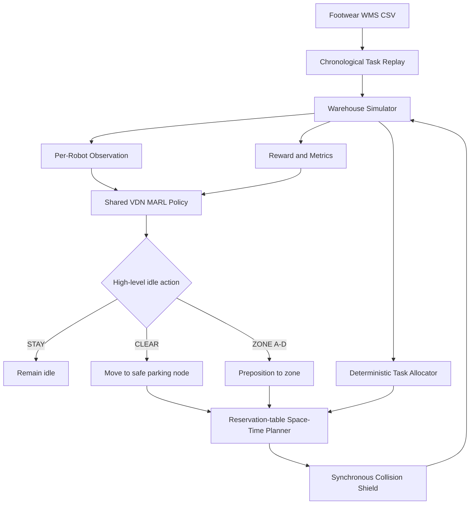

# 팀 공유용 브리핑 — Lifelong MAPFUA 기반 스마트 창고 v5

## 0. 한 문장 요약

**작업이 없는 유휴 로봇을 단순히 세워 두지 않고, 현재 창고 상황에 따라 `STAY(정지)`, `CLEAR(병목 비우기)`, `PREPOSITION(수요 구역 선배치)` 중 무엇을 해야 하는지를 다중 에이전트 강화학습으로 학습하며, 실제 이동은 충돌 인식형 고전 계획기가 안전하게 수행하는 프로젝트**입니다.

권장 영문 제목:

> **Safety-Shielded MARL for Lifelong MAPF with Unassigned Robots in WMS-Derived Warehouses**

권장 한국어 제목:

> **실제 WMS 작업 스트림에서 유휴 로봇의 정지·병목 해소·수요 선배치를 학습하는 안전 제약형 다중 에이전트 강화학습**

---

## 1. 왜 기존 v4에서 방향을 바꾸는가

v4는 Zone별 수요를 예측하고, 조건이 맞으면 유휴 로봇을 미리 배치하는 Adaptive Hybrid 시스템입니다. 작동 자체는 검증됐지만, 다음 반박을 피하기 어렵습니다.

> “수요 예측과 선배치는 이미 대형 물류기업과 기존 연구에서 사용하지 않나요?”

맞는 지적입니다. 따라서 v5는 “예측 기반 경로 최적화를 새로 발명했다”는 주장을 하지 않습니다. 대신 최신 논문이 아직 후속 과제로 남긴 더 구체적인 문제를 다룹니다.

> **현재 목표가 없는 로봇도 공간을 점유한다. 이 로봇은 가만히 있어야 하는가, 다른 로봇의 길을 비워야 하는가, 다음 작업을 대비해 이동해야 하는가?**

예측은 이 문제를 푸는 선택적 입력 중 하나로 내려갑니다. 프로젝트의 중심은 **유휴 로봇의 장기 협력 의사결정**입니다.

---

## 2. MAPF → Lifelong MAPF → MAPFUA

### 2.1 MAPF

Multi-Agent Path Finding은 여러 로봇이 각자의 출발점에서 목표점으로 이동하면서 다음 충돌을 피하는 문제입니다.

- **Vertex conflict**: 같은 시간에 두 로봇이 같은 셀을 점유
- **Edge conflict**: 같은 시간에 두 로봇이 서로의 셀을 맞교환

### 2.2 Lifelong MAPF

일회성 목표가 아니라 작업이 계속 들어오는 창고 문제입니다.

```text
작업 배정 → 이동 → 피킹 완료 → 새 작업 배정 → 반복
```

목표는 한 번의 최단 경로가 아니라 장시간 운영 중 처리량과 대기시간을 개선하는 것입니다.

### 2.3 MAPFUA

MAPF with Unassigned Agents는 **현재 목표가 없는 로봇**을 명시적으로 다룹니다.

- assigned robot: 처리할 작업과 목적지가 있음
- unassigned robot: 현재 작업이 없지만 공간을 점유함

유휴 로봇의 선택:

```text
STAY        현재 위치 유지
CLEAR       활성 로봇의 경로를 막을 가능성이 큰 위치에서 빠짐
PREPOSITION 다음 작업 가능성이 높은 Zone으로 이동
```

핵심은 모든 유휴 로봇을 움직이는 것이 아닙니다. **움직여야 할 로봇만 선택적으로 움직이고, 이동 비용보다 전체 시스템의 이익이 커야 합니다.**

---

## 3. 최신 논문에서 확인한 연구 공백

### 3.1 Felner & Stern, AAAI 2026 — MAPFUA

논문은 기존 MAPF가 거의 항상 모든 로봇에 목표가 있다고 가정하지만, 실제 창고에는 작업이 없는 로봇이 존재한다고 지적합니다. 유휴 로봇은 그대로 있거나 assigned robot의 길을 비우기 위해 움직일 수 있습니다.

논문이 제시한 세 가지 대표 비용은 다음입니다.

1. assigned robot의 서비스 시간 또는 처리량
2. 전체 로봇 이동량, 즉 Fuel
3. 움직인 유휴 로봇 수, 즉 NUA

특히 논문은 다음을 직접 후속 연구로 제시합니다.

- MAPFUA를 Lifelong 환경으로 확장
- 작업이 계속 들어올 때 계획과 실행을 어떻게 교차할지 연구
- 시간에 따른 전체 시스템 행동 최적화
- 밀집 구역과 희소 구역을 동적으로 탐지하고 처리량을 유지

**v5가 직접 구현하는 공백이 바로 Lifelong MAPFUA입니다.**

### 3.2 Giuffrida et al., Robotics and Autonomous Systems 2025

학습 기반 MAPF 방법은 주로 무작위 맵에서 훈련·평가되며, 창고형 좁은 통로와 선반 구조에서는 성능이 달라질 수 있음을 실증했습니다. 일부 학습 방법은 고전 계획법과 비슷한 경로 품질을 보였지만 충돌이 완전히 보장되지 않는 문제가 남았습니다.

저자들이 제시한 후속 방향:

- 탐색 기반 방법과 학습 기반 방법의 하이브리드
- 구성요소별 ablation
- 환경별 fine-tuning
- 동적으로 변하는 환경
- 실제 로봇 적용

v5는 **고수준 의사결정만 MARL에 맡기고 충돌 없는 저수준 경로는 고전 계획기로 처리**합니다. 또한 실제 WMS CSV에서 만든 시간순 작업 replay로 평가합니다.

### 3.3 Phan et al., AAMAS Journal 2026 — CACTUS

이 연구는 과도하게 복잡한 MAPF MARL 구조 대신 경량 curriculum을 제안했습니다. 논문은 다음을 후속 과제로 남깁니다.

- 규칙 기반 shielding 등 다른 충돌 방지 구조
- 필요한 대기와 불필요한 대기의 구분
- 높은 에이전트 밀도
- 부분 관측 아래의 다중 에이전트 최적성
- 고정된 에이전트 수를 넘어선 확장

v5는 복잡한 end-to-end 경로 학습 대신 **공유 VDN 정책 + 안전 계획기 + 부하 밀도 curriculum**을 사용합니다.

### 3.4 Zheng et al., JAIR 2026 — RL-RH-PP

이 연구는 RL이 저수준 한 칸 이동을 직접 선택하게 하지 않습니다. RL은 로봇 계획 우선순위를 학습하고, 실제 충돌 없는 경로는 rolling-horizon 고전 계획기가 생성합니다.

이 논문이 보여주는 중요한 산업형 설계 원칙은 다음입니다.

> **학습은 고전 계획기를 대체하기보다, 고전 계획기가 어려워하는 고수준 선택을 안내한다.**

v5 역시 같은 원칙을 따르지만, 학습 대상은 assigned robot의 계획 우선순위가 아니라 **unassigned robot의 STAY/CLEAR/PREPOSITION 행동**입니다.

### 3.5 LNS2+RL, AAAI 2025

MARL과 고전 계획법을 결합하는 연구는 이미 존재합니다. 따라서 다음은 신규성 주장이 아닙니다.

- “MARL과 A*를 처음 결합했다.”
- “창고에 MARL을 처음 적용했다.”

v5의 차별성은 결합 자체가 아니라 **Lifelong MAPFUA라는 문제 정의, WMS 기반 연속 작업, 유휴 로봇 행동, 비용·지표 설계**에 있습니다.

---

## 4. 연구 질문과 가설

### 핵심 연구 질문

> **동적으로 작업이 유입되는 창고에서 유휴 로봇은 언제 정지하고, 언제 병목을 비우며, 언제 수요 구역으로 선배치되어야 장기 시스템 성능이 좋아지는가?**

### 세부 질문

1. 모든 유휴 로봇을 정지시키는 것보다 선택적 이동이 실제로 유리한가?
2. 단순 주차 규칙보다 밀집도·경로 차단 정보를 반영한 정책이 유리한가?
3. 고정 규칙보다 MARL이 대기시간·이동량·병목의 trade-off를 더 잘 학습하는가?
4. 수요 예측을 MARL 관측에 추가하면 실질적인 이득이 있는가?
5. 이득이 있더라도 정책 추론시간과 유휴 이동비용을 포함하면 여전히 유리한가?

### 검증 가설

- **H1**: 희소 상황에서는 MARL이 대부분 STAY를 선택해 불필요한 이동을 줄인다.
- **H2**: 밀집 병목에서는 일부 유휴 로봇만 CLEAR해 assigned robot의 대기와 blocking pressure를 줄인다.
- **H3**: 반복적인 Zone 급증에서는 PREPOSITION을 선택해 작업 대기시간을 줄인다.
- **H4**: forecast를 넣은 정책이 forecast 없는 정책보다 항상 좋지는 않으며, 그 추가 가치를 ablation으로 검증할 수 있다.
- **H5**: 안전 shield로 최종 vertex/edge 충돌을 0으로 유지한다.

---

## 5. v5 시스템 구조



### 역할 분리

| 계층 | 담당 역할 |
|---|---|
| WMS replay | 실제 기반 작업이 언제, 어디에서 발생하는지 제공 |
| MARL | 현재 유휴 로봇의 고수준 협력 행동 선택 |
| task allocator | 이미 발생한 작업을 수행할 로봇 배정 |
| space-time planner | 시간 예약을 고려한 안전 경로 생성 |
| collision shield | 실행 직전 vertex/edge 충돌을 최종 차단 |
| 수요 예측 | 선택적 관측 및 ablation 입력 |

### MARL이 하지 않는 일

- 한 tick마다 위/아래/왼쪽/오른쪽을 직접 선택하지 않음
- 안전을 학습에만 맡기지 않음
- 작업 중인 로봇을 임의로 다른 Zone으로 보내지 않음
- 예측값을 생성하지 않음

---

## 6. 상태·행동·보상

### 에이전트

각 로봇이 하나의 agent입니다. 동형 로봇이므로 하나의 공유 네트워크를 사용합니다.

### 행동 공간

```text
0 STAY
1 CLEAR
2 ZONE_A
3 ZONE_B
4 ZONE_C
5 ZONE_D
```

작업 중인 로봇은 action mask에 의해 STAY/현재 작업 지속만 허용됩니다.

### 관측의 핵심

- 자신의 위치, Zone, 상태, 배터리
- Zone별 대기 작업 수
- Zone별 현재 로봇 수
- 각 Zone까지의 거리
- 주변 로봇 밀도
- 자신이 활성 로봇의 예상 경로를 막는 정도
- 최근 작업 발생량
- 선택적으로 Zone별 수요 예측

### 팀 보상

현재 구현의 간결한 공동 보상:

```text
+ 완료 작업
- 현재 대기 작업
- 전체 이동거리
- 유휴 로봇 이동거리
- blocking pressure 증가
- 잘못되거나 실행 불가능한 행동
```

보상은 모든 로봇이 공유합니다. 로봇 한 대의 편의가 아니라 전체 fleet 성과를 학습하도록 설계했습니다.

---

## 7. 안전 경로 계층

v5는 각 로봇의 독립 A*만 사용하지 않습니다. 시간축 예약을 포함한 prioritized space-time A*를 사용합니다.

- 다른 로봇이 특정 시점에 점유할 셀 예약
- 반대 방향 edge swap 예약
- 필요하면 wait action 포함
- 목표 도착 후 일정 horizon 동안 목표 셀 유지
- 실행 시 동기식 collision shield로 재검사

주의할 점:

> 현재 계획기는 실용적인 prioritized planner이며, 모든 MAPFUA 문제에 대해 최적성이나 완전성을 보장하는 CBS/EECBS 구현은 아닙니다.

이 제한은 발표에서 숨기지 않습니다.

---

## 8. 데이터는 어떻게 쓰이는가

### 원본 데이터

- `Picking_Wave.csv`
- `Storage_Location.csv`

### 전처리 결과

- `footwear_replay_tasks.csv`: MARL 환경에서 시간순으로 발생하는 작업
- `footwear_location_map.csv`: 실제 위치를 격자와 Zone에 매핑
- `historical_tasks.csv`: 과거 수요 기록
- `training_table.csv`: 선택적 수요 예측 모델 학습
- `footwear_manifest.json`: 시간축과 전처리 가정 기록

MARL에서 CSV는 정답 행동을 주는 데이터가 아닙니다.

> CSV는 에이전트가 시행착오를 경험하는 실제 기반 환경을 구성합니다.

실제 timestamp가 없는 경우 현재처럼 wave 순서를 보존하고 `minutes-per-wave`로 시뮬레이션 시간축을 보정합니다. 발표에서는 실제 시간이라고 과장하지 않고 **WMS-derived calibrated replay**라고 표현합니다.

---

## 9. 비교 정책

| 정책 | 의미 |
|---|---|
| `idle_stay` | 유휴 로봇은 항상 현재 위치 유지 |
| `nearest_parking` | 가장 가까운 빈 주차 노드로 이동 |
| `density_clear` | blocking/density가 높은 유휴 로봇만 비움 |
| `forecast_rule` | v4 방식의 규칙 기반 수요 선배치 |
| `vdn_no_forecast` | 현재 교통·대기열만 보는 MARL |
| `vdn_with_forecast` | 현재 상태와 수요예측을 함께 보는 MARL |

이 ablation으로 다음을 분리합니다.

- 단순히 유휴 로봇을 움직인 효과
- 밀집도 규칙의 효과
- MARL의 효과
- 수요예측 정보의 추가 가치

---

## 10. 평가 지표

### 운영 성능

- 완료 작업 수와 완료율
- 시간당 처리량
- 평균 대기시간
- P95 대기시간
- 전체 이동거리
- 작업 수행 이동거리

### MAPFUA 전용 지표

- 유휴 로봇 이동거리
- 움직인 유휴 로봇 수
- CLEAR / PREPOSITION / PARK 이벤트 수
- 추정 useful idle move rate
- unnecessary idle move events
- blocking pressure ticks

### 안전·실행 가능성

- vertex conflict detected
- edge conflict detected
- collision shield waits
- deadlock count
- path plan failures
- high-level decision latency 평균/P95
- 전체 wall-clock 실행시간

### 지표 해석 주의

- `blocking_pressure_ticks`는 활성 로봇의 정적 최단경로 lookahead에 유휴 로봇이 놓였는지 세는 **진단용 proxy**입니다. 실제 물리적 지연시간 자체가 아닙니다.
- `estimated_useful_idle_move_rate_pct`는 CLEAR 당시 blocking이 양수였는지, PREPOSITION 후 일정 시간 안에 같은 Zone 작업이 배정됐는지를 이용한 **heuristic estimate**입니다.

---

## 11. 현재 구현 완료 범위

### 완료

- 시간 예약 기반 collision-aware path planner
- vertex/edge conflict 검출과 실행 shield
- MAPFUA 유휴 행동 및 네 가지 규칙 baseline
- WMS task replay의 시간순 train/validation/test 분할
- 로봇별 observation과 action mask
- parameter-sharing VDN
- Double-DQN target과 joint replay
- 저·중·고 작업 밀도 curriculum
- validation 기준 best checkpoint 저장
- forecast 없는/있는 모델 ablation
- matched WMS window 다중 seed 평가
- MAPFUA 전용 지표와 계산시간 기록
- side-by-side Pygame MAPFUA 데모
- 자동 테스트

### 아직 완료되지 않은 연구 단계

- 사용자 전체 Footwear 데이터에서 충분한 episode 학습
- 최종 hyperparameter tuning
- 여러 robot count에 대한 별도 학습 및 일반화 검증
- 실제 로봇 검증
- 최적/완전 MAPFUA solver 비교
- 통신 지연·로봇 고장·통로 폐쇄 stress test

코드 파이프라인이 동작하는 것과 학습된 정책이 baseline보다 우수한 것은 다른 주장입니다. 최종 성능은 팀 컴퓨터에서 실제 데이터로 학습·평가한 뒤에만 제시합니다.

---

## 12. 발표에서 사용할 안전한 기여 문장

### 사용 권장

> AAAI 2026이 후속 연구로 제시한 Lifelong MAPFUA를 실제 WMS 기반 연속 작업 환경으로 구체화했다.

> 유휴 로봇 행동을 정지, 병목 해소, 수요 선배치의 장기 협력 의사결정으로 정의했다.

> 학습 정책은 고수준 결정을 담당하고, 충돌 인식형 고전 계획기와 safety shield가 실제 경로를 실행한다.

> 예측 없는 MARL과 예측 보조 MARL을 비교해 수요예측의 실질적 가치를 별도로 검증한다.

### 사용 금지

- 세계 최초 창고 MARL
- 최초 MAPFUA
- 최초 MARL + A*
- Amazon보다 좋은 경로 최적화
- 충돌이 이론적으로 절대 불가능
- 실제 timestamp를 그대로 재현
- 최적 MAPFUA solver

---

## 13. 해커톤 데모 스토리

1. `idle_stay`에서는 작업이 없는 로봇이 좁은 통로에 남아 있음
2. 작업 로봇의 경로와 대기열이 증가
3. `density_clear` 또는 MARL이 blocking이 큰 유휴 로봇 일부만 CLEAR
4. 수요가 특정 Zone에 반복되면 일부 로봇은 PREPOSITION
5. 작업이 몰리거나 행동이 위험하면 action mask와 shield가 차단
6. 대기시간·이동거리·유휴 이동·병목 proxy·추론시간을 동시에 비교
7. forecast 없는 MARL과 forecast 있는 MARL 결과를 보여 예측의 가치가 실제로 있었는지 정직하게 결론

---

## 14. 팀 역할 분담 예시

| 담당 | 작업 |
|---|---|
| 데이터 | CSV 전처리, manifest 검증, 시간순 분할 확인 |
| 시뮬레이션 | 병목 시나리오, 주차 노드, 충돌 테스트 |
| MARL | VDN 학습, reward/epsilon/episode tuning |
| 실험 | baseline/ablation, seed 평가, 표·그래프 작성 |
| UI·발표 | Pygame 데모, 연구 질문·논문·한계 정리 |

---

## 15. 핵심 참고문헌

1. Felner, A., & Stern, R. (2026). **Multi-Agent Path Finding with Unassigned Agents (MAPFUA)**. AAAI 2026. DOI: `10.1609/aaai.v40i46.41322`
2. Giuffrida, A., Basilico, N., & Amigoni, F. (2025). **An empirical evaluation of learning-based multi-agent path finding algorithms in warehouse environments**. Robotics and Autonomous Systems, 194, 105149. DOI: `10.1016/j.robot.2025.105149`
3. Phan, T. et al. (2026). **Confidence-Based curricula for multi-agent path finding via reinforcement learning**. Autonomous Agents and Multi-Agent Systems, 40, 23. DOI: `10.1007/s10458-026-09747-7`
4. Zheng, H. et al. (2026). **Learning-guided Prioritized Planning for Lifelong Multi-Agent Path Finding in Warehouse Automation**. Journal of Artificial Intelligence Research, 85, Article 28. DOI: `10.1613/jair.1.20611`
5. Wang, Y. et al. (2025). **LNS2+RL: Combining Multi-agent Reinforcement Learning with Large Neighborhood Search in Multi-agent Path Finding**. AAAI 2025. DOI: `10.1609/aaai.v39i22.34501`
6. Fu, B. et al. (2026). **Symbolic Planning and Multi-Agent Path Finding in Extremely Dense Environments with Unassigned Agents**. AAAI 2026. DOI: `10.1609/aaai.v40i35.40183`
